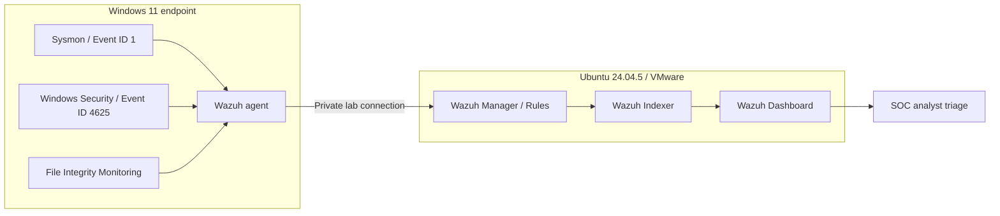
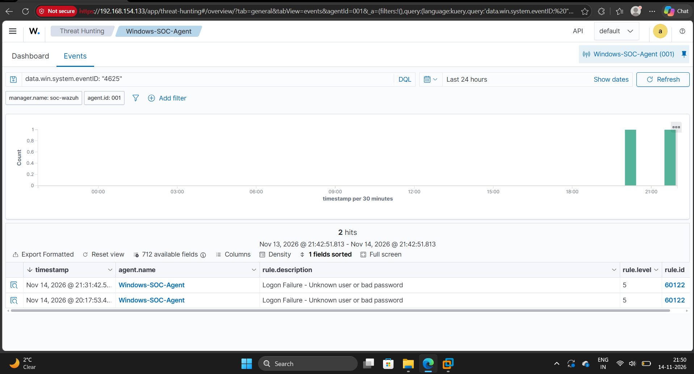
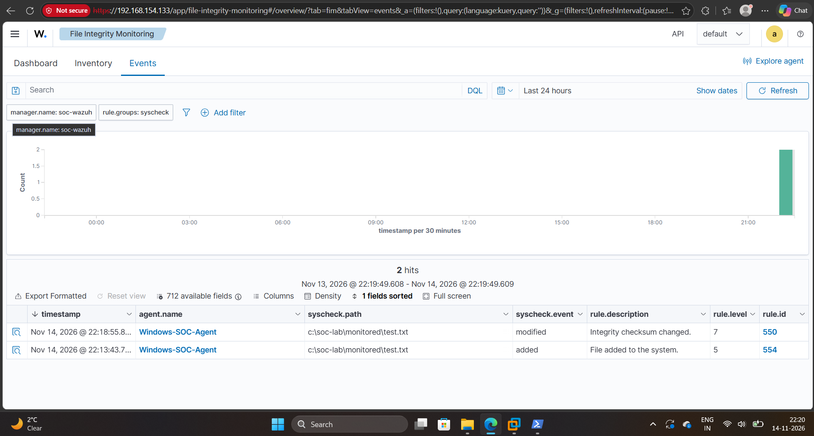
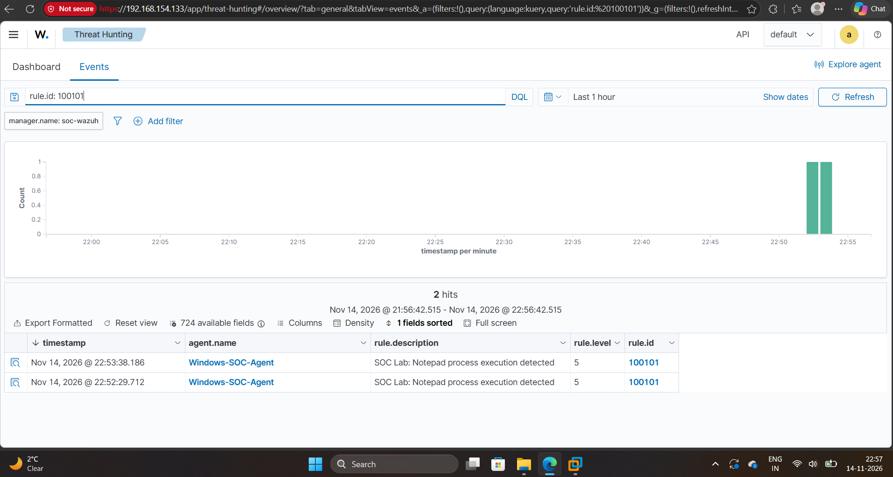

# SOC Monitoring & Incident Response Lab

**An evidence-backed, self-hosted Security Operations Centre (SOC) portfolio project**  
**Author:** Rooturaj Kalaskar · MSc Cyber Security, University of East Anglia  
**Project period:** November 2026

> **Scope:** This is a controlled personal lab, not production SOC employment or a confirmed breach. Authentication failures, file changes, and Notepad execution were deliberately generated for detection validation. One alert investigation was assessed as *likely benign*, not definitively proven harmless.

## At a glance

| Component | Implementation |
|---|---|
| SIEM | Wazuh 4.14.10 — Manager, Indexer, Dashboard |
| Server | Ubuntu Server 24.04.5 LTS in VMware Workstation |
| Endpoint | Windows 11 Home with Wazuh agent and Microsoft Sysmon |
| Monitored agents | **1 active Windows endpoint** (`Windows-SOC-Agent`) |
| Telemetry | Sysmon process creation (Event ID 1), Windows Security logs, real-time File Integrity Monitoring |
| Validation | **4 investigation/detection scenarios**, supported by **17 screenshots** |

## What I built

A single-endpoint home SOC that forwards endpoint security telemetry to Wazuh for centralized alerting, investigation, and rule validation. I configured a Windows Wazuh agent and Sysmon, investigated an alert's parent-process chain, tested failed authentication monitoring and file-integrity changes, and implemented a custom Wazuh detection rule.

## Verified scenarios

| # | Test | Observed Wazuh outcome | Evidence |
|---|---|---|---|
| 1 | Investigate `SecEdit.exe` / PowerShell alert | Rule **92066**; process chain traced to `wazuh-agent.exe`; assessed *likely expected security-policy checking* | [Figures 5–6](docs/EVIDENCE_INDEX.md) |
| 2 | Controlled failed network logon with nonexistent test account | Windows Event **4625**, logon type **3**, Wazuh Rule **60122**, level **5** | [Figures 7–9](docs/EVIDENCE_INDEX.md) |
| 3 | Create and modify a monitored test file | Rule **554** (added, level **5**) and Rule **550** (modified, level **7**); hashes and file size changed | [Figures 10–12](docs/EVIDENCE_INDEX.md) |
| 4 | Open `Notepad.exe` to validate a custom rule | Sysmon Event **1**, custom Rule **100101**, level **5** | [Figures 13–14](docs/EVIDENCE_INDEX.md) |

### Selected evidence

**Authentication detection — Rule 60122**  

**File-integrity monitoring — Rule 550**  

**Custom detection — Rule 100101**  

## Reports

- **[Full technical report (19 pages)](Reports/Rooturaj_Kalaskar_SOC_Lab_Technical_Report.pdf)** — architecture, methodology, findings, limitations and all 17 evidence screenshots.
- **[Recruiter summary (2 pages)](Reports/Rooturaj_Kalaskar_SOC_Lab_Recruiter_Summary.pdf)** — concise overview and selected supporting evidence.
- [Evidence index](docs/EVIDENCE_INDEX.md) — description of every screenshot, including corrected descriptions where legacy filenames are misleading.
- [Testing and validation notes](docs/TESTING_AND_FINDINGS.md) — exact detections, field interpretation and scope limits.
- [Reproduction guide](docs/REPRODUCTION_GUIDE.md) — high-level setup and safe test commands.

## Detection and agent configuration

- [`Configurations/local_rules.xml`](Configurations/local_rules.xml) — validated Wazuh custom Notepad process-execution rule.
- [`Configurations/windows_agent_config_snippet.xml`](Configurations/windows_agent_config_snippet.xml) — **illustrative extracts only** for Sysmon EventChannel collection and real-time FIM. Merge into the installed agent configuration; do **not** replace your whole `ossec.conf` with this snippet.

The rule detects a deliberately benign program. In a real SOC it is a **test/demonstration rule**, not evidence that Notepad is malicious.

## Technical skills demonstrated

Security monitoring · Endpoint telemetry · Windows Event IDs · Sysmon · SIEM triage · Process ancestry analysis · Windows authentication audit analysis · File Integrity Monitoring · Hash comparison · Custom detection engineering · Technical reporting · Linux administration · Troubleshooting

## Reproduce or learn from this lab

Start with [the reproduction guide](docs/REPRODUCTION_GUIDE.md). Use **your own devices, isolated lab and dummy accounts**. No external system or production environment was tested.

## Limitations and responsible disclosure

- All findings come from a **single personal Windows endpoint**; no enterprise-scale deployment, production incident response or external penetration test is claimed.
- Windows Security Event 4625 reflects a deliberately failed login, not a real intrusion.
- The `SecEdit.exe` process chain is consistent with Wazuh-triggered auditing, so the disposition is *likely benign*, not a forensic proof of the entire host's safety.
- The screenshots contain **private-network IPs and local host/user identifiers**. Review [PUBLICATION_CHECKLIST.md](docs/PUBLICATION_CHECKLIST.md) before making the repository public. No credentials are intentionally included.
- Live Wazuh credentials, agent keys, certificates, full system logs, and private host configurations are **not distributed**.

## Portfolio / CV wording

> Built a Wazuh SIEM home lab integrating Windows Security logs and Sysmon; validated failed-logon detection (Event 4625), real-time file-integrity monitoring, and a custom process-execution rule; investigated alert process ancestry and documented technical findings.

---

*Technical evidence is provided for educational and portfolio purposes. Figure numbering follows the supplied evidence and report.*
